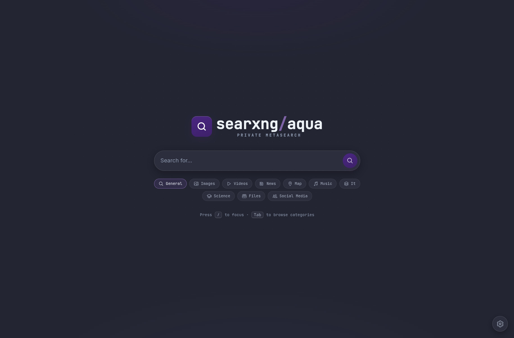

<p align="center">
  
</p>

<h1 align="center">SearXNG AQUA</h1>

<p align="center">
  A privacy-focused SearXNG metasearch front end with the AQUA theme, a custom
  RAMA-derived interface, and a Konsole desktop launcher.
</p>

<p align="center">
  
  
  
</p>

<p align="center">
  
</p>

---

SearXNG AQUA is a local fork and customisation of
[SearXNG](https://github.com/searxng/searxng) and the
[SearXNG RAMA](https://github.com/Nomadcxx/searxng-RAMA) theme. It is not
affiliated with or endorsed by either upstream project.

## Features

- AQUA wordmark, page title and footer.
- Five colour controls for accent, background, cards, text and muted text.
  Values are stored in the browser and applied on every page.
- Search UI fixes for the image viewer, infobox spacing, category pill borders,
  pagination boxes and Previous/Next alignment.
- A back-to-top button that scrolls the page, with Left and Right placement
  under Preferences > User Interface.
- Home glow and favicon that follow the chosen accent.
- A Konsole launcher with live logs. Closing the window stops the server.
- Desktop entry and systemd template.

## Quick start (from source)

Requirements: Python 3.11 or newer, a C toolchain and the SearXNG system
libraries (`libxml2`, `libxslt`, `libffi`, `openssl`, `zlib`). On Arch Linux,
the packages used by `searxng-rama` cover these.

```bash
git clone https://github.com/AquaDanCookie/SearXNG-AQUA.git
cd SearXNG-AQUA

python3 -m venv app/venv
app/venv/bin/pip install -r app/requirements.txt

cp app/searx/settings.example.yml app/searx/settings.yml
# Edit app/searx/settings.yml and set server.secret_key to a unique value.

./bin/searxng-aqua-console
```

The launcher opens <http://localhost:8855/> once the server is ready and keeps
the server attached to its Konsole window. Closing the window stops it.

The example settings bind to `127.0.0.1` and use port `8855`. Change
`server.bind_address` only if you want LAN access.

### Desktop shortcut

```bash
./packaging/install-desktop.sh
```

This installs a per-user KDE/XDG desktop entry, an AQUA icon, and a
`~/.local/bin/searxng-aqua-console` symlink. The app then appears as
SearXNG AQUA in the application menu.

## Configuration

The active configuration is `app/searx/settings.yml` (ignored by git). Start
from `app/searx/settings.example.yml` and set at least:

```yaml
general:
  instance_name: "SearXNG AQUA Edition"
server:
  port: 8855
  bind_address: "127.0.0.1"
  limiter: false
  secret_key: "CHANGE_ME"
```

The active `settings.yml` is excluded from the repository so personal keys and
engine choices stay local.

### Theme colours and layout

Open Preferences > User Interface.

Theme colours provides five colour pickers and a Reset to theme button. The
values are stored in browser storage for the `http://localhost:8855/` origin.

Back to top button offers Left side and Right side.

### systemd (optional)

`packaging/searxng-aqua.service.in` is a template for a system service. Replace
`@USER@` and `@APP_DIR@`, install the unit, and enable it only if you do not
want to use the Konsole launcher.

### Arch / AUR base (optional)

The repository is a full source tree and does not require the AUR package.
`packaging/` contains the desktop entry, icon and systemd template.

## Project layout

```text
app/                 SearXNG source tree with the prebuilt theme
bin/                 Portable Konsole launcher
fixes/               Reapplied UI-fix CSS and JS source
packaging/           Desktop, systemd and icon helpers
docs/images/         README screenshot
```

The UI fix CSS and JS are in `fixes/` and already applied to the shipped theme
bundles under `app/searx/static/themes/simple/`. No build step is required.

## Updating

```bash
git pull
app/venv/bin/pip install -r app/requirements.txt
```

Your `app/searx/settings.yml` is ignored by git and is preserved.

## Version

- AQUA 1.1.3
- Based on SearXNG RAMA 1.1.3 and SearXNG `2026.11.5+3e95f6cd2`

The user-facing brand is AQUA. The packaging and upstream source still use the
`searxng-rama` package name, the `/opt` path, theme variant file names and
`RAMA-UI-FIX` marker names for compatibility.

## Credits

- [SearXNG](https://github.com/searxng/searxng): the metasearch engine, AGPL-3.0.
- [SearXNG RAMA](https://github.com/Nomadcxx/searxng-RAMA): the RAMA theme and
  package base, AGPL-3.0.
- AQUA branding, UI fixes and local integration in this fork.

## License

Distributed under the GNU Affero General Public License v3.0. See
[LICENSE](LICENSE). SearXNG and SearXNG RAMA are also AGPL-3.0 projects.
